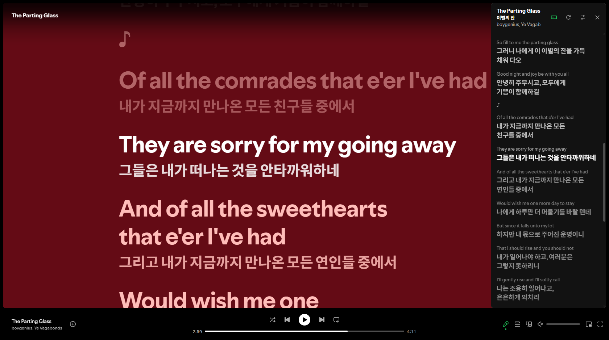
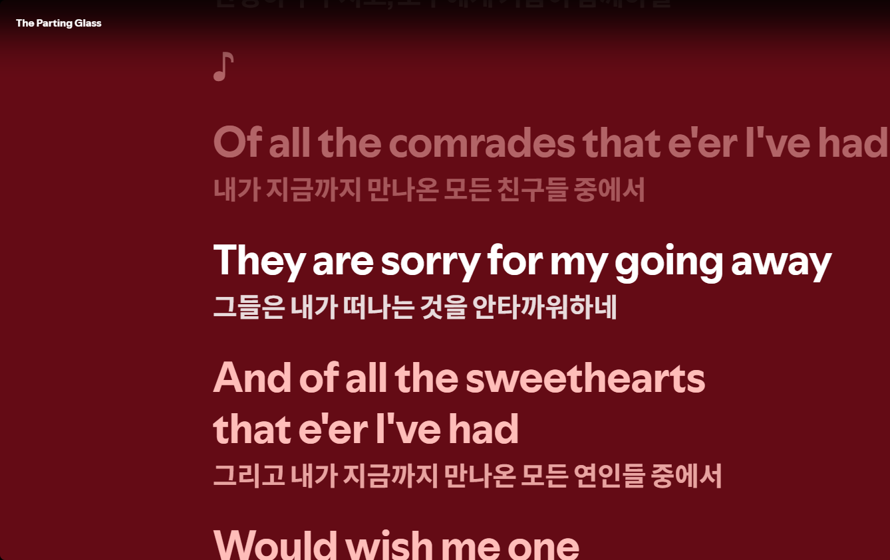
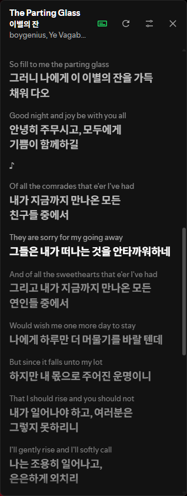
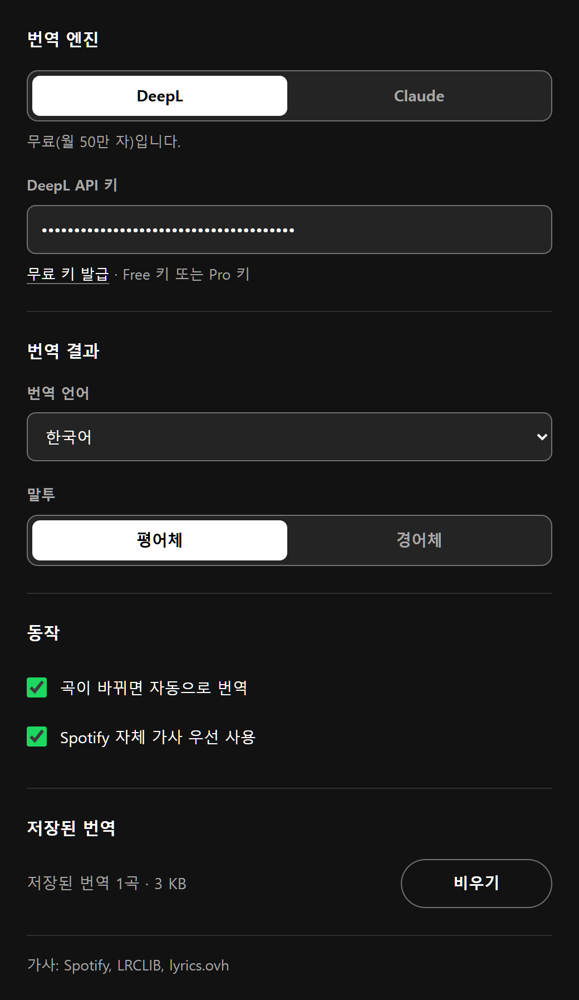

<h1 align="center">
  <br>
  Versify
</h1>

<p align="center">
  <a href="LICENSE"></a>
  
</p>

<p align="center">
  <strong>English</strong> · <a href="README_KR.md">한국어</a>
</p>

<p align="center">
  <strong>Real-time lyrics translation for the Spotify web player.</strong><br>
  Every line, translated in place, in sync with the song.
</p>

<p align="center">
  
</p>

## Features

<table>
  <tr>
    <td width="50%">
      <h3>Translations inside Spotify's lyrics</h3>
      Open Spotify's own lyrics view and each line gets its translation right underneath. Nothing to switch to, nothing to scroll separately.
    </td>
    <td width="50%">
      
    </td>
  </tr>
  <tr>
    <td width="50%">
      
    </td>
    <td width="50%">
      <h3>A lyrics panel that follows the song</h3>
      A side panel shows the original and the translation together and highlights the current line as it plays. With synced lyrics, click any line to jump there. Drag it anywhere, or double-click its header to dock it back. <kbd>Alt</kbd>+<kbd>L</kbd> toggles it.
    </td>
  </tr>
  <tr>
    <td width="50%">
      <h3>Your engine, your tone</h3>
      Translate with DeepL (free tier works) or Claude. The whole song goes along as context, and one register is kept for every line: casual or polite, never a mix.
    </td>
    <td width="50%">
      
    </td>
  </tr>
</table>

Also in the box:

- **Four lyrics sources.** Spotify's own synced lyrics first, then [LRCLIB](https://lrclib.net), then [Bugs](https://music.bugs.co.kr) (unofficial endpoints, for Korean songs LRCLIB lacks), then [lyrics.ovh](https://lyrics.ovh). No account or key needed for any of them.
- **Four target languages.** Korean, Japanese, Chinese (Simplified) and English.
- **Translate once, keep it.** Finished translations are cached on your device, so replaying a song costs nothing. Clear the cache from settings at any time.
- **Repeated lines stay consistent.** A chorus is translated once and reused, so it reads the same every time.
- **Keyboard friendly.** Arrow keys move between lines, <kbd>Enter</kbd> plays from the focused line, and the panel announces its state to screen readers.

## Install

Versify is not on the Chrome Web Store yet. Load it from source:

1. Download or clone this repository.
2. Open `chrome://extensions` and turn on **Developer mode**.
3. Click **Load unpacked** and select the project folder.
4. Open the Versify settings and paste an API key:
   - **DeepL**: get a free key at [deepl.com/pro-api](https://www.deepl.com/pro-api). Free (`:fx`) and Pro keys both work.
   - **Claude**: create a key at [console.anthropic.com](https://console.anthropic.com/settings/keys). Usage is billed to your Anthropic account.
5. Play a song on [open.spotify.com](https://open.spotify.com).

Requires Chrome 111 or later. The extension's interface is currently in Korean.

## Privacy

- Versify has no server. Lyrics come straight from Spotify, LRCLIB, Bugs or lyrics.ovh, and translations go straight from your browser to DeepL or Anthropic.
- When LRCLIB has no match for a romanized artist name (for example "Yutaka Ozaki"), Versify sends that artist name to [MusicBrainz](https://musicbrainz.org) to look up the original-script name (尾崎豊). It sends nothing else.
- API keys are stored only on your device (`chrome.storage.local`) and are never synced.
- Translation calls are capped at 20 songs per tab every 10 minutes, so a misbehaving page cannot burn through your quota.

## Developing

No build step. Edit the files and reload the extension in `chrome://extensions`.

```bash
node tests/selfcheck.mjs      # offline checks: LRC parsing, lyrics lookup order, DeepL/Claude mapping, i18n keys
node tests/live-deepl.mjs     # real DeepL call; needs DEEPL_API_KEY in the environment or .env.local
```

```
background/   service worker: lyrics lookup, translation, cache
content/      reads the current track and playback position from the player
lyrics/       LRCLIB, Bugs, lyrics.ovh and MusicBrainz clients
translate/    DeepL and Claude clients, shared tone rules
ui/           side panel, native lyrics overlay, popup, settings
_locales/     every user-facing string
```

Versify is an independent project. It is not affiliated with or endorsed by Spotify, DeepL or Anthropic.

---

Versify is released under the [MIT License](LICENSE). © 2026 Hwaryuh
