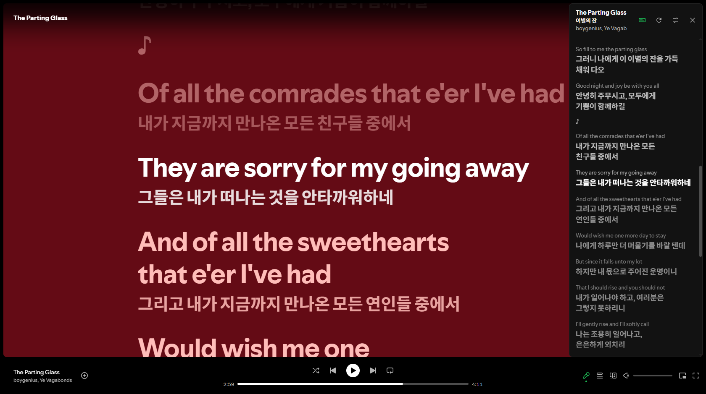
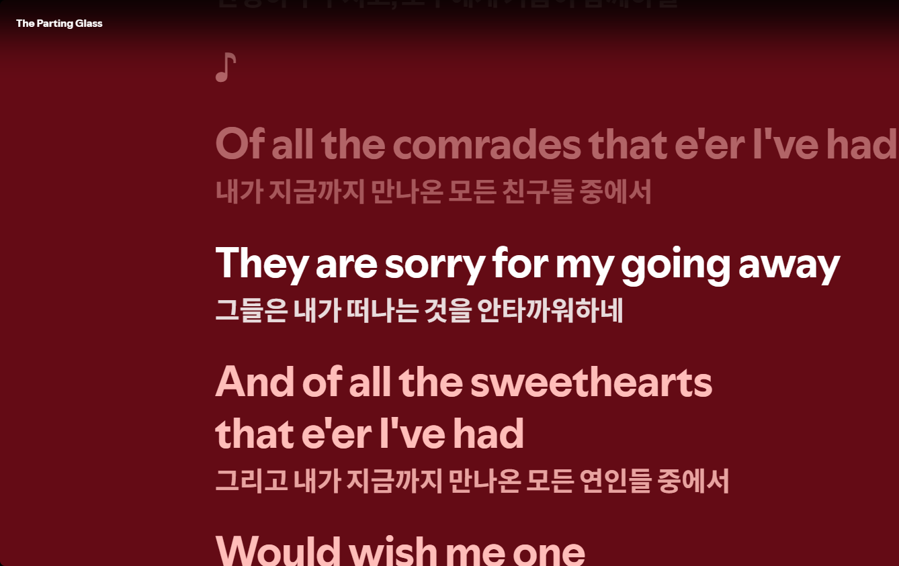
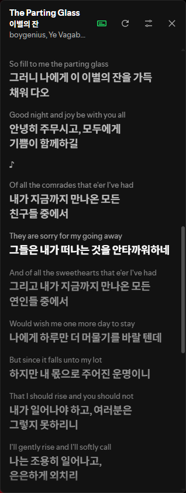
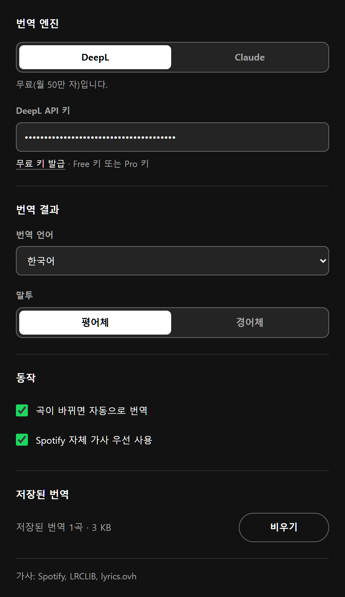

<h1 align="center">
   
  Versify
</h1>

  
  

  <a href="README.md">English</a> · <strong>한국어</strong>

  <strong>Spotify 웹 플레이어용 실시간 가사 번역</strong> 
  곡에 따른 번역된 가사를 표시합니다.

  

## 기능

<table>
  <tr>
    <td width="50%">
      <h3>Spotify 가사 화면 안에서 번역</h3>
      Spotify의 원본 가사 아래에 번역된 가사가 표시됩니다. 다른 탭으로 가지 않아도 됩니다!
    </td>
    <td width="50%">
      
    </td>
  </tr>
  <tr>
    <td width="50%">
      
    </td>
    <td width="50%">
      <h3>가사 패널</h3>
      원문과 번역이 같이 표시되며, 가사를 클릭하여 해당 위치로 이동할 수 있습니다. 패널은 원하는 곳으로 옮길 수 있습니다. <kbd>Alt</kbd>+<kbd>L</kbd>로 활성/비활성화할 수 있습니다.
    </td>
  </tr>
  <tr>
    <td width="50%">
      <h3>개인 설정</h3>
      DeepL(무료 요금제 가능)이나 Claude로 번역합니다. 가사를 선택한 말투로 통일할 수 있습니다.
    </td>
    <td width="50%">
      
    </td>
  </tr>
</table>

그 밖에:

- **가사 출처**: Spotify 자체 가사, [LRCLIB](https://lrclib.net), [lyrics.ovh](https://lyrics.ovh) 순으로 검색합니다.
- **번역 지원 언어**: 한국어, 일본어, 중국어(간체), 영어
- **캐시**: 완료된 번역은 기기에 캐시되므로 같은 곡을 다시 들어도 비용이 들지 않습니다. 캐시는 설정에서 언제든 지울 수 있습니다.
- **키보드 지원**: 방향키로 옮기고, <kbd>Enter</kbd>로 선택한 라인부터 재생합니다.

## 설치

소스에서 직접 불러오기:

1. 이 저장소를 내려받거나 clone 합니다.
2. `chrome://extensions`를 열고 **개발자 모드**를 켭니다.
3. **압축해제된 확장 프로그램을 로드합니다**를 누르고 프로젝트 폴더를 고릅니다.
4. Versify 설정을 열고 API 키를 붙여 넣습니다.
   - **DeepL**: [deepl.com/pro-api](https://www.deepl.com/pro-api)에서 무료 키를 받을 수 있습니다. 무료(`:fx`) 키와 Pro 키 모두 됩니다.
   - **Claude**: [console.anthropic.com](https://console.anthropic.com/settings/keys)에서 키를 만듭니다. 사용 요금은 본인 Anthropic 계정에 청구됩니다.
5. [open.spotify.com](https://open.spotify.com)에서 노래를 재생합니다.

Chrome 111 이상이 필요하며, 현재 한국어로만 제공됩니다.

## 개인정보

- Versify에는 서버가 없습니다. 가사는 Spotify, LRCLIB, lyrics.ovh에서 검색하고, 번역 요청은 브라우저에서 DeepL이나 Anthropic으로 전송합니다.
- API 키는 이 기기(`chrome.storage.local`)에만 저장되고 동기화되지 않습니다.
- 번역 호출은 탭마다 10분에 20곡까지로 제한합니다. 페이지가 오작동해도 사용량이 한꺼번에 소진되지 않습니다.

Versify는 독립 프로젝트입니다. Spotify, DeepL, Anthropic과 관계가 없고 이들의 승인을 받지 않았습니다.

---

Versify는 [MIT 라이선스](LICENSE)로 배포됩니다. © 2026 Hwaryuh
